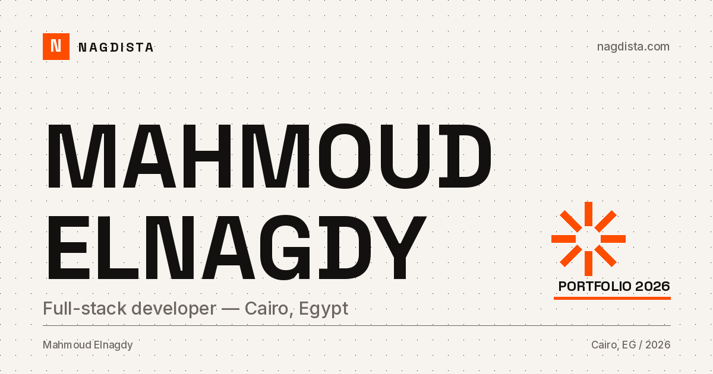

# nagdista.com

Personal portfolio for **Mahmoud Elnagdy** — a full-stack developer in Cairo, Egypt.



Bilingual by design: English lives at `/`, Arabic at `/ar`, with proper `lang`/`dir` roots, localized
metadata, and RTL-aware layouts. The site is a fully static export, so it can be hosted anywhere.

## Stack

- **Next.js 16** (App Router, static export)
- **React 19** + **TypeScript**
- **Tailwind CSS v4** with a small custom design system
- **pnpm**
- WebForms.to for the contact form
- GitHub REST API at build time for the public-repository section

## Local development

```bash
pnpm install
pnpm dev          # http://localhost:3000
```

Build the static site:

```bash
pnpm build        # outputs to out/
python3 -m http.server 4173 -d out
```

Lint:

```bash
pnpm lint
```

## Configuration

Create a `.env.local` file (both variables are optional):

```bash
# Public CV link. Defaults to the Drive folder configured in src/content/site.ts.
NEXT_PUBLIC_CV_URL="https://drive.google.com/..."

# Contact form endpoint. Defaults to the WebForms.to endpoint in src/content/site.ts.
NEXT_PUBLIC_CONTACT_ENDPOINT="https://send.webforms.to/..."
```

A `GITHUB_TOKEN` can be provided at build time to raise the GitHub API rate limit while generating
the repository list. The build falls back to a checked-in snapshot if the API is unavailable.

## Deployment

Production runs on **Vercel** at <https://nagdista.com>. Pushes to `main` deploy automatically; the
project is a static export, so any static host works too.

The old Vercel project and the old GitHub repository are kept as `portfolio-legacy`. The GitHub
Pages workflow remains available as a static preview/backup.

## Structure

```
src/
  app/
    (en)/            English routes
    (ar)/ar/         Arabic routes (root layout with dir="rtl")
    global-not-found.tsx
  components/        UI, project covers, timeline, forms
  content/           Bilingual copy, projects, articles, site constants
  lib/               SEO helpers, GitHub fetching, feeds
public/
  og/                Generated social images (24, EN + AR)
scripts/
  generate-og.py     Rebuilds the OG images with PIL
```

## SEO

- Per-page canonical URLs and `hreflang` alternates (`en`, `ar`, `x-default`)
- Localized titles/descriptions, Open Graph and Twitter cards
- `Person` + `WebSite` JSON-LD, article and project metadata
- `sitemap.xml`, `robots.txt`, RSS feeds, and `llms.txt`
- Static HTML for every route; no client-side rendering required to read content

## Notes

- Testimonials are intentionally a placeholder until real quotes are available. No fabricated
  testimonials.
- Case-study copy is written from the actual project work; screenshots are CSS motifs rather than
  stock mockups.
- The GitHub section excludes forks and archived repositories.

## License

Content and personal branding © Mahmoud Elnagdy. The code is available for reference; please do not
republish the written content or personal assets as your own.
